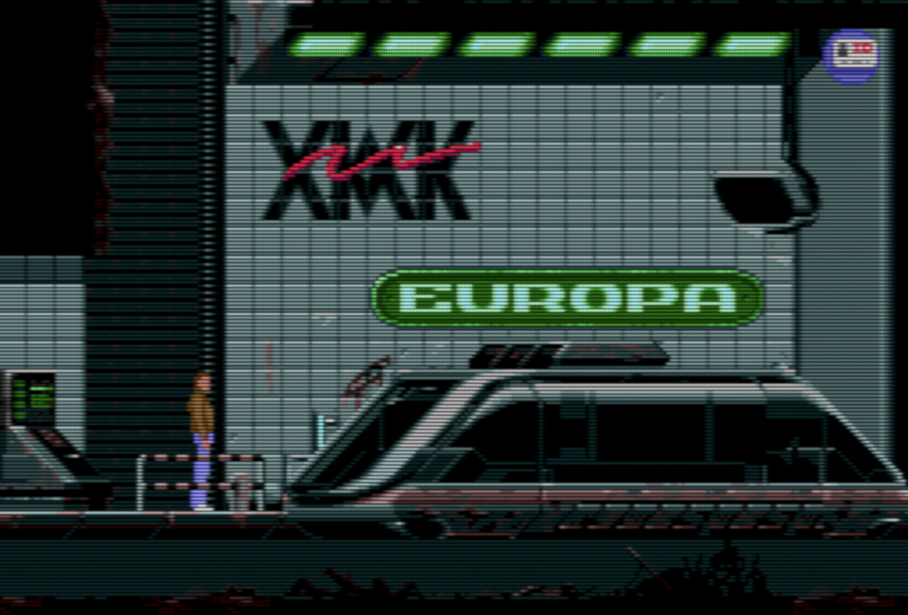

# REminiscence fork with CRT emulation shader



## Credits
Original [REminiscence](http://cyxdown.free.fr/reminiscence/) author Gregory Montoir.

Delphine Software, makers of the 1992 game [Flashback](https://en.wikipedia.org/wiki/Flashback_(1992_video_game)).

## Added features
* CRT shader based on the one used in [TIC-80](https://github.com/nesbox/TIC-80)
* Fullscreen by default.
* Always preserving original aspect ratio.
* 4x scale in windowed mode.
* macOS app bundle.

## Build dependencies
* CMake > 3.19
* SDL3
* [libmodplug](http://modplug-xmms.sourceforge.net)
* [stb_vorbis.c](https://github.com/nothings/stb/blob/master/stb_vorbis.c)
* [zlib](https://www.zlib.net)
* [opl3](https://github.com/nukeykt/Nuked-OPL3/blob/master/opl3.c)
* [mt32emu](https://github.com/munt/munt/tree/master/mt32emu)
* [macdylibbundler](https://github.com/auriamg/macdylibbundler) (Only needed for building macOS app)

Put data files from the original game in DATA/

Use CMake to build the rs executable.

```bash
cmake -DCMAKE_BUILD_TYPE=Release -DCMAKE_MAKE_PROGRAM=ninja -G Ninja -S . -B build
```

```bash
cmake --build build --target all -j 6
```

To build Flashback.app (optional):

```bash
./build_app.sh
```

## Assets/DATA
Requires DATA files from the original game, either DOS (Recommended) or Amiga (Not tested).
DOS files from GOG probably work. Filenames should be uppercase.

Get Amiga MOD music files from here: [UnExoticA](https://www.exotica.org.uk/wiki/Flashback).
Put files directly in the DATA/ folder. These should be in lowercase.

There is also optional Adlib MIDI support. If you want Roland MT32 you need MT32_CONTROL.ROM, MT32_PCM.ROM.

For speech find VOICE.VCE from the Sega CD version and put in DATA/ folder.

## Run
You can run the rs executable in the build directory

```bash
./rs
```

```bash
./rs --windowed
```

```bash
./rs --mididriver=mt32
```

The Mac .app is standalone, with all dependencies inside the bundle.
